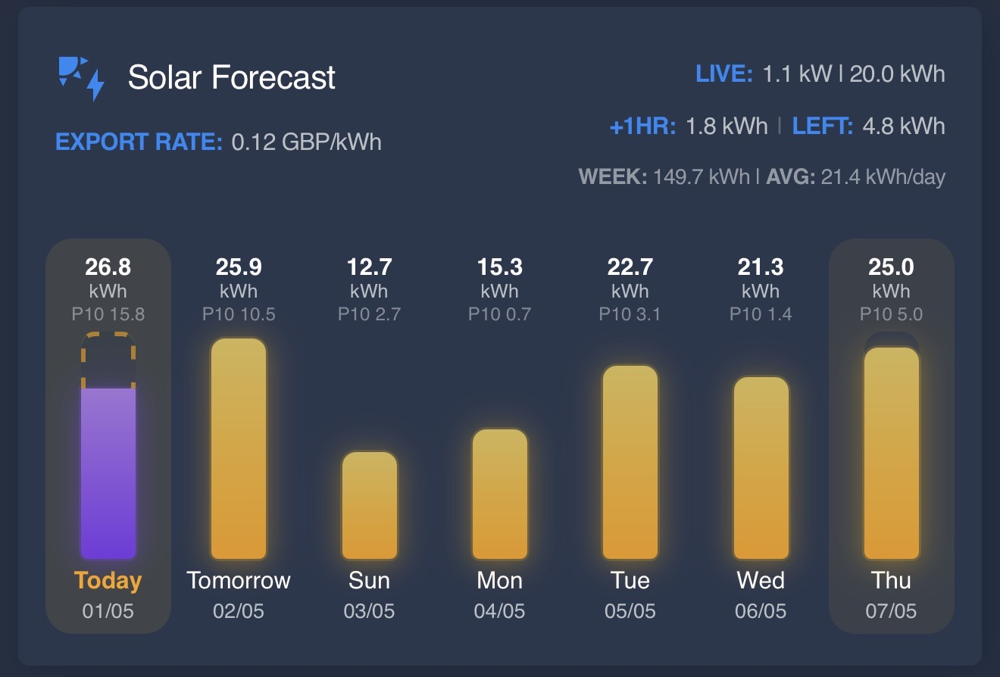
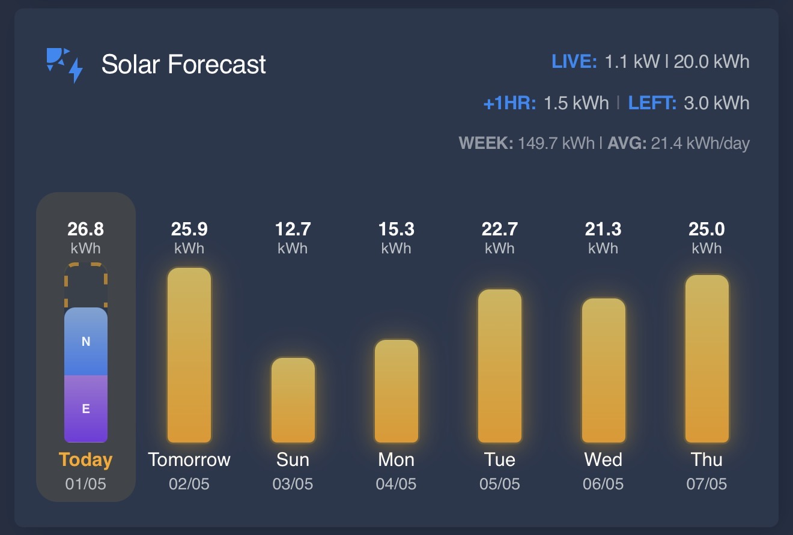
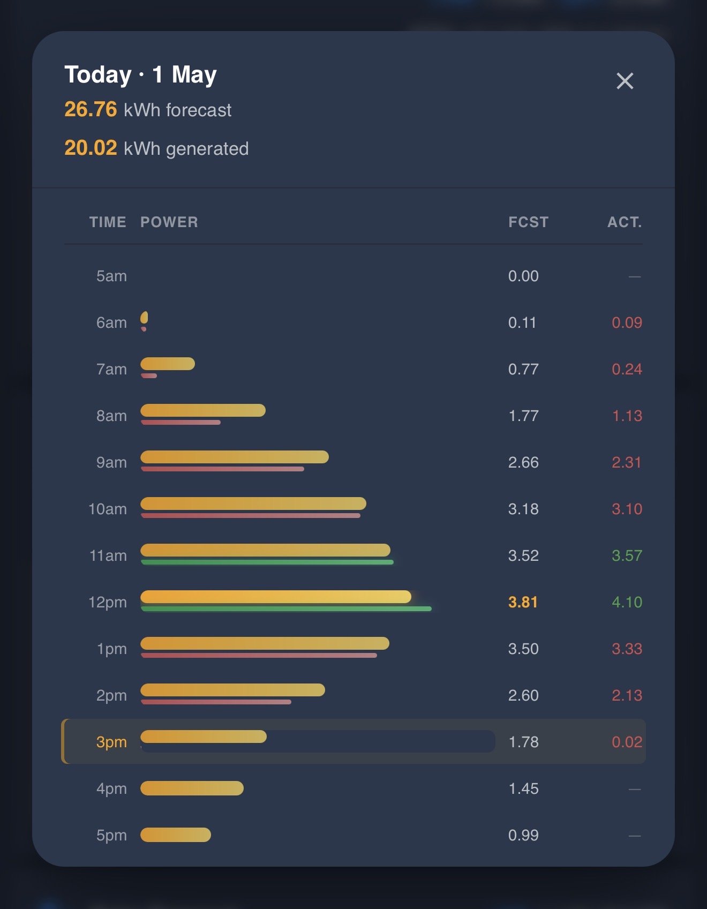

# Solar Forecast Card

A Home Assistant Lovelace custom card for displaying solar energy forecast data supplied by any forecasting integration, with simple setup for use with the Volcast, Solcast, Forecast.Solar, and Open-Meteo Solar Forecast integrations by selecting the relevant device in the card configuration to allow the auto-mapping of daily forecast entities.

## Support

This card is provided completely free of charge, but if you want to support me or just say thanks by buying me a coffee, that would mean so much!

<a href="https://www.buymeacoffee.com/AshGSmith" target="_blank"></a>

## Screenshots

### Main card



### Main card with multiple arrays



### Hourly forecast popup



## Installation

### HACS (Recommended)
#### Install via HACS

1. Open HACS in your Home Assistant instance.
2. Click on the **⋮** button on the top right and select **Custom repositories***
3. Enter the below in the **Repository** field
```url
https://github.com/AshGSmith/solar-forecast-card
```
4. Select **Dashboard** as the **Type** and Add.
5. Search for **Solar Forecast Card** and install it.
6. Reload your browser.

### Manual

1. Download `solar-forecast-card.js` from the [latest release](../../releases/latest).
2. Copy it to your `config/www/` folder (e.g. `config/www/solar-forecast-card.js`).
3. In Home Assistant, go to **Settings → Dashboards → Resources** and add:
   - URL: `/local/solar-forecast-card.js`
   - Resource type: **JavaScript module**
4. Reload your browser.

## Configuration

Add the card to a dashboard using the card picker, or add it manually in YAML:

```yaml
type: custom:solar-forecast-card
title: Solar Forecast          # optional — defaults to "Solar Forecast"
icon: mdi:solar-power          # optional — defaults to mdi:solar-power
show_header: true              # optional — defaults to true
display_estimate10: false      # optional — Solcast only, shows P10 forecast values
main_view: daily               # optional — daily, hourly or history
device_id: <your_device_id>    # optional — auto-detects forecast entities
forecast_entities:
  - sensor.forecast_today
  - sensor.forecast_tomorrow
  - sensor.forecast_day_3
  - sensor.forecast_day_4
  - sensor.forecast_day_5
  - sensor.forecast_day_6
  - sensor.forecast_day_7
live_power_entity: sensor.solar_power_now
today_actual_entity: sensor.solar_energy_today
export_rate_entity: sensor.current_export_rate
next_hour_entity: sensor.solar_forecast_next_hour
remaining_today_entity: sensor.solar_forecast_remaining_today
actual_arrays:
  - entity: sensor.solar_east_array_energy_today
    label: E
  - entity: sensor.solar_west_array_energy_today
    label: W
inverter_max_kw: 5.0
solar_max_kwp: 4.2
desktop_text_scale: 100
low_threshold: 10
high_threshold: 30
low_threshold_entity: sensor.solar_low_threshold    # optional — overrides low_threshold
high_threshold_entity: sensor.solar_high_threshold  # optional — overrides high_threshold
show_low_threshold_zone: true                       # optional — tints the bar track below low
show_high_threshold_zone: true                      # optional — tints the bar track above high
threshold_zone_opacity: 15                          # optional — tint strength, 5 to 100
```

### Options

#### Card

| Option | Type | Required | Default | Description |
|--------|------|----------|---------|-------------|
| `type` | string | yes | — | Must be `custom:solar-forecast-card` |
| `title` | string | no | `Solar Forecast` | Text displayed in the card header |
| `icon` | string | no | `mdi:solar-power` | MDI icon shown to the left of the title (e.g. `mdi:solar-power-variant`) |
| `show_header` | boolean | no | `true` | Show or hide the card header, including the title and live data badge |
| `display_estimate10` | boolean | no | `false` | When enabled with the Solcast integration, shows a secondary P10 (10th-percentile) forecast value below each day's main forecast total |

#### Hourly Forecasts

Clicking a daily forecast column opens an hourly popup when hourly data is available from the configured integration. The popup reuses the same hourly data normalisation across Volcast, Solcast, Forecast.Solar, and Open-Meteo Solar Forecast.

For today's forecast, the hourly popup can also compare actual generation against the forecast:

- Forecast generation remains the main hourly bar.
- Actual generation is shown as a slim comparison bar where actual history is available.
- The Actual value is softly coloured red, amber, or green depending on whether it is below, matching, or above the forecast value.
- The current hour is highlighted without changing row layout or value alignment.

Set `main_view: hourly` to display today's hourly forecast directly on the main card instead of the 7-day daily forecast bars. The older `show_hourly_as_main: true` setting still works.

#### Forecast History

Set `main_view: history`, or choose **History** under **Main View** in the card editor's **Display** section, to see how close the forecast was to what you generated over the last 7 full days. Today isn't included because it isn't finished.

The view shows:

- **Accuracy:** 100% minus the average percentage miss across the days compared.
- **Average miss per day:** the typical size of the miss in kWh, whichever direction it went.
- **Actual vs forecast per day:** the average difference. A positive number means you generated more than forecast.
- **Chart:** a dashed forecast line and a solid actual line. The space between them is green where you beat the forecast and red where you fell short. Tap a day to see its numbers.

The score only uses days with both a forecast and an actual, so it can cover fewer than 7 days.

**Forecast data** is read from these sources in order, and each one fills days the previous source didn't have:

1. Home Assistant's recorder history for the first forecast entity, using the value in place at 06:00. If there's no reading by then, the day's first reading is used.
2. The card's own log (see below).
3. Solcast only: past forecasts from the integration's own storage, so the line appears right away. These are Solcast's last forecast for each period, so they can look more accurate than a morning forecast. This needs a version of the Solcast integration with the `query_forecast_data` action.

Other integrations need the first forecast entity to be recorded, which Home Assistant does by default for 10 days.

**Actual generation** is read from these sources in order:

1. Long-term statistics for `actual_arrays` or `today_actual_entity`. This is the same data the Energy dashboard uses. It works whether the sensor resets daily or is a lifetime total, and isn't limited to the recorder's 10 days. If neither option is set and `live_power_entity` is an energy sensor in kWh or Wh, that sensor is used.
2. Long-term statistics for the solar sources in your Energy dashboard, so `today_actual_entity` can be left empty.
3. An estimate from `live_power_entity`, adding up its hourly averages.
4. The sensor's highest value that day from recorder history, which needs a sensor that resets daily.
5. The card's own log.

A sensor has long-term statistics when it has a `state_class`, such as `total_increasing`. To check, open **Developer Tools → Statistics** and search for it.

**The card's own log** is saved automatically in Home Assistant's per-user storage on every view, keeping 8 days. It stores the first forecast seen each day and the highest actual seen. It can only save while a dashboard containing the card is open, so it can't fill days nobody opened. A logged actual counts only if the card was open after sunset, because an earlier reading would be a partial day. Each Home Assistant user has a separate log.

**Troubleshooting:**

| What you see | What to check |
|--------------|---------------|
| *No forecast history found* | Make sure the first forecast entity is set and recorded. Open **History** in the Home Assistant sidebar and look at that sensor. It may be listed under `exclude` in your `recorder:` configuration, or missing from an `include` list. |
| Forecast line but no actual line | Set `today_actual_entity` to an energy sensor, or add solar to the Energy dashboard. Check the sensor appears in **Developer Tools → Statistics**. |
| Actuals look too high or too low | Check the sensor reports energy (kWh or Wh), not power. Power-based estimates are approximate, and a lifetime total needs long-term statistics. |
| Values appear a day out | Days follow the timezone of the device viewing the card. Compare with a device in the same timezone as Home Assistant. |

#### Device & Entities

| Option | Type | Required | Default | Description |
|--------|------|----------|---------|-------------|
| `device_id` | string | no | — | Home Assistant device ID. When set, forecast entities are auto-detected from the device. Supports Volcast, Solcast, Forecast.Solar, and Open-Meteo Solar Forecast integrations |
| `forecast_entities` | list | yes | — | Exactly 7 sensor entity IDs representing Day 1 (today) through Day 7. Each sensor must expose a numeric state (kWh) and, for hourly popup support, an `hours` or `wh_period` attribute |

#### Live Data

| Option | Type | Required | Default | Description |
|--------|------|----------|---------|-------------|
| `live_power_entity` | string | no | — | Sensor reporting current solar output. Accepts W or kW (detected via `unit_of_measurement`). Displayed in the header as `LIVE: X W` or `X.X kW` |
| `today_actual_entity` | string | no | — | Sensor reporting total energy generated today (kWh or Wh). Used as the actual generation source when no `actual_arrays` are configured. Shown in the header and used to render the actual generation bar on today's column |
| `next_hour_entity` | string | no | — | Sensor reporting forecast generation for the next full hour (kWh or Wh). When set, overrides the auto-derived `+1HR` header value. Auto-populated from the Solcast and Open-Meteo integrations where available |
| `remaining_today_entity` | string | no | — | Sensor reporting remaining forecast generation for today (kWh or Wh). When set, overrides the auto-derived `LEFT` header value. Auto-populated from the forecast.solar and Open-Meteo integrations |
| `export_rate_entity` | string | no | — | Sensor reporting the current energy export rate. When set, displays `EXPORT RATE: X unit` in the card header below the title |

#### Actual Generation Arrays

The `actual_arrays` option lets you configure individual per-array energy sensors to display a proportional stacked breakdown on today's actual-generation bar. When two or more arrays are producing, the bar is divided into coloured segments sized in proportion to each array's output. The card header and the hourly popup both show a per-array breakdown alongside the overall total.

This field is entirely optional. When omitted, the card behaves exactly as in previous versions.

| Option | Type | Required | Default | Description |
|--------|------|----------|---------|-------------|
| `actual_arrays` | list | no | — | List of per-array sensor entries. When configured, array totals are always used in preference to `today_actual_entity` for the actual generation display |

Each entry in `actual_arrays`:

| Field | Type | Required | Description |
|-------|------|----------|-------------|
| `entity` | string | yes | Sensor entity reporting energy generated by this array today. Accepts kWh or Wh (detected via `unit_of_measurement`) |
| `label` | string | yes | Single character shown inside the segment on the bar and in the popup header (e.g. `N`, `S`, `E`, `W`) |

**Example:**

```yaml
actual_arrays:
  - entity: sensor.solar_east_array_energy_today
    label: E
  - entity: sensor.solar_west_array_energy_today
    label: W
```

**Behaviour notes:**

- When arrays are configured, their sum is used as the actual generation total in the card header and bar. `today_actual_entity` is not used for display when arrays are present.
- The stacked bar activates when 2 or more arrays are producing. A single active array uses the standard single-colour bar.
- If all array sensors read zero (e.g. pre-sunrise) or are unavailable, the bar falls back to `today_actual_entity` for its height. The header will show `0.0 kWh` from the arrays.
- Each segment is drawn from an 8-slot colour palette (purple, blue, indigo, slate-blue, violet, emerald, periwinkle, steel) and shows its label when the segment is tall enough to fit it.
- Arrays are configured manually in the visual editor via the **Actual Generation Arrays** expansion panel.

#### System

| Option | Type | Required | Default | Description |
|--------|------|----------|---------|-------------|
| `inverter_max_kw` | number | no | — | Inverter maximum continuous output in kW. Used as the ceiling for hourly popup bar scaling when the solar array is at or above this value |
| `solar_max_kwp` | number | no | — | Solar array peak capacity in kWp. Used as the hourly graph ceiling when smaller than `inverter_max_kw`. If neither system value is set, bars scale relative to the day's peak hour |

#### Display

| Option | Type | Required | Default | Description |
|--------|------|----------|---------|-------------|
| `main_view` | string | no | `daily` | What the main card shows: `daily`, `hourly` or `history` |
| `desktop_text_scale` | number | no | `100` | Scales card text on wider screens only. Accepts values from 100 to 150 in the visual editor; mobile sizing is unchanged |
| `font_size` | number | no | — | Optional daily forecast value and day/date label size in pixels. Leave unset to use CSS/default styling |
| `bar_width` | number | no | — | Optional daily forecast bar width in pixels. Leave unset to use CSS/default styling |

#### Language and date/time format

The card follows the active Home Assistant frontend language where a locale is available, with English used as the fallback for any missing translation. Date labels, time labels, and number formatting follow the Home Assistant frontend locale and time settings for the current user.

To change how dates and times are shown in the card, update your Home Assistant user/browser preferences:

1. Open Home Assistant.
2. Select your user profile.
3. Update the language, number format, time format, or related locale settings.
4. Refresh the dashboard if the card does not update immediately.

#### Colour Thresholds

Bar colours change based on each day's forecast total. When neither threshold is set all bars use the default amber colour. A day exactly on a threshold stays amber.

| Option | Type | Required | Default | Description |
|--------|------|----------|---------|-------------|
| `low_threshold` | number | no | — | Days forecast below this value (kWh) are shown in a soft red/coral colour |
| `high_threshold` | number | no | — | Days forecast above this value (kWh) are shown in green |
| `low_threshold_entity` | string | no | — | Sensor that supplies the low threshold. Overrides `low_threshold` while it has a usable value |
| `high_threshold_entity` | string | no | — | Sensor that supplies the high threshold. Overrides `high_threshold` while it has a usable value |
| `show_low_threshold_zone` | boolean | no | `false` | Tint the bar track red below the current low threshold |
| `show_high_threshold_zone` | boolean | no | `false` | Tint the bar track green above the current high threshold |
| `threshold_zone_opacity` | number | no | `15` | Opacity of the threshold tints as a percentage, from 5 to 100. Lower values are more transparent |

##### Threshold sensors

Use a threshold sensor when the value should change over time, such as a helper you adjust or a seasonal template sensor. The bars and tints update as soon as the sensor changes.

- The entity must be a `sensor.`, such as a template sensor. An `input_number` helper needs a template sensor in front of it.
- Its state must be a number of 0 or more. Sensors reporting Wh are converted to kWh.
- If the sensor is `unavailable`, `unknown`, not a number or negative, the card uses `low_threshold` or `high_threshold` instead. Setting both gives you a fallback.

##### Threshold tints

The tints show where your thresholds sit on the chart, without adding lines over the bars. Each one can be turned on separately under **Colour Thresholds** in the card editor.

- The red tint fills the bar track from the bottom up to the low threshold.
- The green tint fills the bar track from the high threshold up to the top.
- Bars are drawn over the tints, so a tall bar covers the low tint. On a short bar, the tint shows how far the day is from the next threshold.
- Tints use the same scale as the bars, which is set by the week's highest forecast. They move as the forecast changes, and a tint is hidden while its threshold is above the highest forecast.
- Tints only appear on the daily view.
- `threshold_zone_opacity` sets the strength of both tints. To set each colour yourself, use `--sfc-low-threshold-zone-color` and `--sfc-high-threshold-zone-color`. The opacity setting doesn't apply to custom colours, so include any transparency in the colour.

## Card-mod / CSS Customisation

The card exposes CSS custom properties for card-mod and theme-level styling while keeping the default appearance unchanged.

```yaml
card_mod:
  style: |
    solar-forecast-card {
      --sfc-card-background: rgba(20, 20, 30, 0.8);
      --sfc-font-size: 14px;
      --sfc-bar-width: 18px;
      --sfc-actual-color: #a78bfa;
    }
```

Available variables:

| Variable | Area |
|----------|------|
| `--sfc-card-background` | Main card background |
| `--sfc-card-border-radius` | Main card corner radius |
| `--sfc-card-padding` | Main card padding |
| `--sfc-card-box-shadow` | Main card shadow |
| `--sfc-title-color` | Header title colour |
| `--sfc-title-font-size` | Header title size |
| `--sfc-header-label-color` | Header label colour |
| `--sfc-header-value-color` | Header value colour |
| `--sfc-font-size` | Daily forecast values and day/date labels |
| `--sfc-bar-width` | Daily forecast bar width |
| `--sfc-bar-radius` | Daily forecast bar corner radius |
| `--sfc-low-color` | Low forecast bar background |
| `--sfc-average-color` | Average forecast bar background |
| `--sfc-high-color` | High forecast bar background |
| `--sfc-actual-color` | Actual generation bar background |
| `--sfc-low-threshold-zone-color` | Low threshold zone colour |
| `--sfc-high-threshold-zone-color` | High threshold zone colour |
| `--sfc-threshold-zone-opacity` | Threshold tint opacity, from 0 to 1. Not used when a zone colour variable is set |
| `--sfc-popup-background` | Popup background |
| `--sfc-popup-border-radius` | Popup corner radius |
| `--sfc-popup-text-color` | Popup primary text colour |
| `--sfc-popup-accent-color` | Popup accent colour |
| `--sfc-history-forecast-color` | History view forecast line |
| `--sfc-history-actual-color` | History view actual line |
| `--sfc-history-over-color` | History view colour when generation beat the forecast |
| `--sfc-history-under-color` | History view colour when generation fell short |

## Development

See the [Developer Guide](docs/developer-guide.md) for the architecture, build and test commands, and how to add integrations and config options.

## License

MIT
